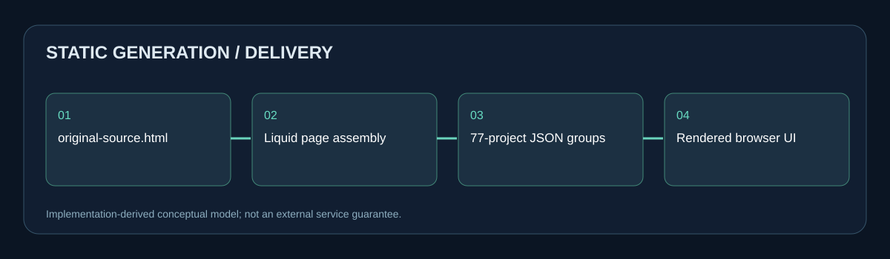
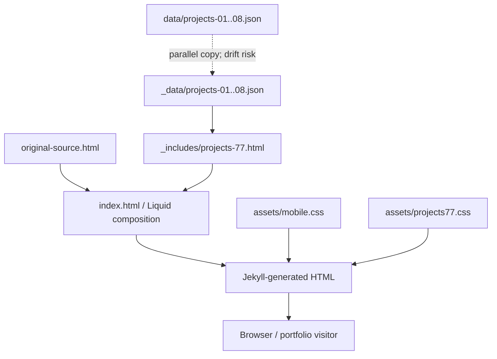
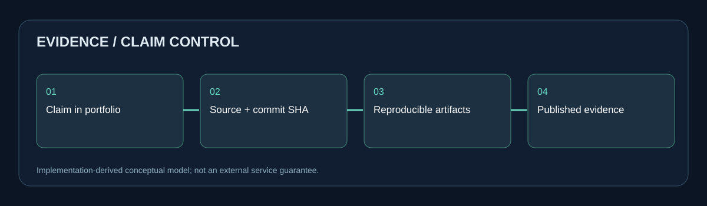

<div align="center">


**SHTENCO · Quantitative Research, Machine Learning, Systems Engineering**

Единая публичная точка доступа к исследовательским системам, исходному коду и техническим материалам. Архитектурное портфолио, а не независимый сертификат зрелости всех связанных проектов.

[Продукт](#продукт-и-его-позиционирование) · [Архитектура](#фактическая-архитектура) · [Данные](#модель-данных-и-источники) · [Инженерия](#инженерные-особенности) · [Достоверность](#достоверность-и-проверяемость) · [Развёртывание](#развёртывание-и-локальный-просмотр) · [Риски](#технические-риски) · [План](#план-развития)

</div>

> **Технический статус:** функционирующий исходный код статического портала с обработкой Liquid-шаблонов и JSON-каталогом проектов. Это не backend, не торговый терминал, не служба вычислений и не источник авторитетных торговых или финансовых результатов.

## Продукт и его позиционирование

Этот репозиторий представляет портфолио SHTENCO как инженерную карту компетенций: математическое моделирование, алгоритмическая торговля, ML/AI, распределённые вычисления, финтех, блокчейн и системная разработка. Ценность портала для инженерного руководителя или рекрутера заключается не в количестве карточек, а в возможности перейти от короткого описания задачи к конкретному исходному коду, документации и доказательствам воспроизводимости.

**Для работодателя** портал сокращает стоимость первичной оценки технического профиля и облегчает навигацию между разными классами задач. **Для исследователя** это карта связанных гипотез и реализаций. **Для потенциального партнёра** — прозрачная граница между готовой программной частью и дальнейшей работой, требующей инженерной или юридической проверки.

### Разделение уровня представления и реализации

| Уровень | Здесь действительно имеется | Не следует выводить из наличия |
|:--|:--|:--|
| Веб-интерфейс | HTML, CSS, JavaScript, Liquid-монтаж страницы | Production API или серверная бизнес-логика |
| Каталог | Восемь JSON-групп с карточками проектов | Верифицированное состояние каждого внешнего репозитория |
| Навигация | Ссылки на проекты, статьи и контакты | Подтверждение текущей работоспособности всех ссылок |
| Визуальные эффекты | Анимации, адаптивные стили, языковые блоки | Гарантированная доступность на каждом устройстве |
| Метрики | Текстовые сведения в презентационном слое | Независимый аудит, доходность или экспертная сертификация |

## Фактическая архитектура



Портал не является простым `index.html`, пригодным для непосредственной отдачи обычным статическим сервером. В текущем `main` входной файл содержит **Jekyll/Liquid-разметку**:

1. `index.html` задаёт `layout: null` и читает `original-source.html` через `include_relative`.
2. Liquid разделяет базовый документ по якорям `products` и `contacts`.
3. Блок каталога вставляется из `_includes/projects-77.html`.
4. Каталог обращается к `site.data` и последовательно обрабатывает группы `projects-01` … `projects-08`.
5. На финальной стадии в `</head>` добавляются `assets/mobile.css` и `assets/projects77.css`.
6. Браузер получает уже собранный HTML, стили и клиентские интерактивные элементы.



Наличие каталога `data/` рядом с `_data/` создаёт риск расхождения зеркальных JSON-файлов. Liquid-шаблон непосредственно использует `site.data`, поэтому рабочим источником на стороне Jekyll выступает `_data/`.

## Модель данных и источники

Восемь групп описывают направления исследований. Каждый проект в JSON имеет, в частности, поля `n`, `repo`, `title`, `why`, `does`, `tier`, `public`.

| Поле | Семантика | Ограничение |
|:--|:--|:--|
| `repo` | Идентификатор GitHub-репозитория | Не доказывает его существование и доступность |
| `why` | Исследовательская или продуктовая мотивация | Не является доказательством решения проблемы |
| `does` | Описание предполагаемой/фактической функции | Нужна проверка соответствия текущему исходному коду |
| `tier` | Редакционная категория портфолио | Не научная метрика зрелости |
| `public` | Разрешение показывать ссылку | Не заменяет проверку публичной доступности |

**Выявленное расхождение:** UI и Liquid-шаблон называют каталог «77 проектов», тогда как доступный аккаунт GitHub сейчас содержит **86 репозиториев**. Эти величины не тождественны: часть репозиториев может быть инфраструктурой или сайтом, а некоторые карточки могут описывать иной срез. Автоматически заменять «77» на «86» без пересборки каталога нельзя. Для корректной витрины нужен пересчитанный manifest с явными правилами включения.

## Инженерные особенности

### Сохранение исходного дизайна

`original-source.html` остаётся исходным большим презентационным документом. Вместо редактирования всех его блоков `index.html` выполняет Liquid-композицию. Это снижает число прямых вмешательств в исходную вёрстку, но делает корректность сборки зависимой от *точного совпадения* строк-разделителей.

### Адаптивная вёрстка

`assets/mobile.css` содержит отдельные правила для ширин **980 px, 650 px и 390 px**. На мобильных экранах перестраиваются главная панель, навигация, сетки карточек, типографика и контейнеры. Часть интенсивных эффектов отключается; горизонтальная прокрутка вкладок обрабатывается явно.

### Каталог карточек

`_includes/projects-77.html` выводит восемь тематических направлений, краткое описание мотивации, функциональности и две повторяющиеся редакционные секции про компетенции и пользу для компании. Это работает как презентация, однако именно **повторение одного общего текста для разных проектов** ухудшает доказательность и индивидуальность портфолио.

### Уровни достоверности

Следует различать:
- **SOURCE PRESENT** — файл или реализация реально лежит в репозитории;
- **TESTED** — предъявлен воспроизводимый результат с командой, окружением и зафиксированным коммитом;
- **EVALUATED** — независимый тест, корректные выборки/сценарии и измеренные границы ошибки;
- **DEPLOYED** — действительно работающая авторизованная система;
- **AUDITED** — отдельно подтверждённые внешним аудитом факты.

Ни одна категория не наследуется автоматически от красивой карточки на сайте.

## Карта репозитория

| Путь | Фактическая функция |
|:--|:--|
| [`index.html`](index.html) | Входная точка Jekyll/Liquid |
| [`original-source.html`](original-source.html) | Базовый оригинальный HTML-документ |
| [`_includes/projects-77.html`](_includes/projects-77.html) | Шаблон вставки карточек |
| [`_data/`](_data/) | Рабочий JSON-каталог для `site.data` |
| [`data/`](data/) | Отдельная копия групп JSON; контроль синхронизации необходим |
| [`assets/mobile.css`](assets/mobile.css) | Адаптивная совместимость интерфейса |
| [`assets/projects77.css`](assets/projects77.css) | Стиль каталога и отдельных карточек |
| [`assets/readme/`](assets/readme/) | Локальная векторная инфографика документации |
| [`docs/README_LEGACY.md`](docs/README_LEGACY.md) | Историческое инженерное описание |

## Достоверность и проверяемость



```text
Публичное утверждение
  -> источник данных / репозиторий
  -> commit SHA и проверяемый путь
  -> версия и среда исполнения
  -> тест / независимая оценка
  -> ограниченное по смыслу утверждение на сайте
```

Этот протокол пока **не внедрён как обязательная автоматическая проверка**. Он является предложенным критерием инженерной публикации. Ни финансовые результаты, ни точность ML, ни измерения производительности других проектов нельзя подтверждать одной лишь страницей портала.

## Развёртывание и локальный просмотр

GitHub Pages способен обрабатывать Jekyll для совместимых репозиториев. Для локального просмотра важно **сначала выполнить Liquid/Jekyll-сборку**, иначе браузер получит директивы `` как текст и каталог проектов не будет корректно смонтирован.

```bash
git clone https://github.com/Shtenco/shtenco.github.io.git
cd shtenco.github.io

# При установленном Ruby/Jekyll, совместимом с GitHub Pages:
jekyll serve
# Открыть указанный Jekyll локальный адрес (обычно localhost:4000).
```

В репозитории отсутствует подтверждённый `Gemfile` с закреплёнными версиями Jekyll. Поэтому команду нельзя считать проверенным one-command setup. Альтернатива — собрать сайт в корректном Jekyll-окружении, а затем отдавать **сгенерированный** каталог `_site/` через обычный HTTP-сервер.

## Технические риски

| Приоритет | Риск | Инженерное действие |
|:--|:--|:--|
| P0 | Несоответствие «77» и текущего портфеля из 86 репозиториев | Формальный реестр включения и автоматическая сверка |
| P1 | Расхождение `data/` и `_data/` | Оставить единый canonical source или проверять зеркала хэшами |
| P1 | Сборка зависит от строковых якорей исходного HTML | Тест Jekyll render и защита от изменения marker-строк |
| P1 | Одинаковые фразы о навыках для каждого проекта | Специализированные evidence-backed описания |
| P1 | Витрина может содержать неподтверждённые KPI | Claim manifest и ссылки на доказательства |
| P2 | Нет видимого автоматизированного QA сайта | HTML validation, link checker, Lighthouse, mobile screenshots |
| P2 | Анимации и внешний контент | Проверка CSP, reduced-motion, keyboard accessibility |

## План развития

**Этап 1 — проверка источника.** Доработать генератор каталога так, чтобы список репозиториев, видимость карточек, количество проектов и ссылки вычислялись из одного реестра.

**Этап 2 — проверка утверждений.** Каждому значимому claim сопоставлять `repository`, `commit_sha`, `evidence_path`, `status` и `verified_at`. Если доказательства нет, показывать исследовательский статус, а не готовый результат.

**Этап 3 — качественная инженерная презентация.** Для каждого проекта создавать уникальную краткую техническую аннотацию: постановка задачи, архитектурный подход, работающие модули, конкурентное отличие, воспроизводимость, известные ограничения, интеграционная роль.

**Этап 4 — автоматические проверки.** Добавить Jekyll build, проверку внутренних и внешних ссылок, регрессию локализации RU/EN, мобильные скриншоты и отдельный отчёт о непроверенных заявлениях.

**Этап 5 — профессиональная демонстрация.** Публиковать технические демонстрации только со связанными исходниками, датами, конфигурациями и честной классификацией результатов.

---

**Итог:** данный репозиторий уже содержит структурированную витрину инженерного портфолио и достаточно гибкий статический интерфейс. Основной следующий шаг — сделать каталог машиночитаемым, синхронизируемым и проверяемым, превратив сильную презентацию исследований в источник инженерно обоснованного доверия.

[Исходники портала](https://github.com/Shtenco/shtenco.github.io) · [SYNERGY SYSTEM](https://github.com/Shtenco/synergy_system) · [SYNERGY EURASIAN — пример доказательного оформления](https://github.com/Shtenco/synergy_eurasian)
